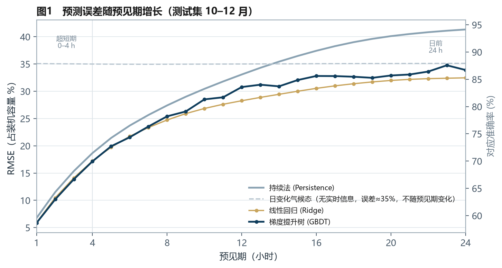

# 风电场功率预测 baseline｜持续法 vs 统计回归

用 ERA5 逐时资料把"功率预测"这条链路跑通：
**风速 → 轮毂高度外推 + 空气密度修正 → 功率曲线换算 → 特征构造 → 四个模型 × 24 个预见期 → RMSE / 准确率 / 合格率 / Skill**。

目的不是做出一个能上生产线的预测系统，而是回答三个问题：
**持续法到底能撑多久？复杂模型值不值？24 h 日前预测的天花板在哪？**



## 关键结果（训练 1–9 月，测试 10–12 月）

| 预见期 | 持续法 准确率 / 合格率 | Ridge 准确率 | GBDT 准确率 / 合格率 | 最优 |
|---|---|---|---|---|
| 1 h | 93.2% / 99.2% | 94.1% | **94.1% / 99.6%** | GBDT（Skill +13.3%） |
| 4 h | 81.3% / 84.5% | 82.8% | **82.8% / 86.7%** | GBDT（Skill +8.1%） |
| 24 h | 58.7% / 46.9% | **67.5%** | 66.1% / **58.1%** | Ridge（Skill +21.4%） |

> 准确率 = (1 − RMSE / 装机) × 100%；合格率 = |误差| ≤ 25% 装机的样本占比；
> Skill = 1 − RMSE_model / RMSE_持续法。

三条结论：

1. **1–2 h 持续法几乎打平复杂模型**（RMSE 6.8% vs 5.9%）。这一时段大气的"记忆"还没耗散，复杂模型只能把误差再压 0.9 个百分点——超短期的投入应该放在观测频率和数据质量上。
2. **7 h 之后 Ridge 的 RMSE 一直低于 GBDT**（24 h：32.5% vs 33.9%）。预见期越长，特征对目标的解释力越弱，平方损失下的最优预测必然向条件均值收缩；线性模型收缩得更狠（预测标准差 0.55 MW、最大只到 3.20 MW），尾部误差更轻；GBDT 保留了更多变化（0.83 MW、最大 5.00 MW），中低出力段更准但尾部更重。
3. **"最优"取决于考核口径**：24 h 按 RMSE 是 Ridge 赢，按合格率是 GBDT 赢（58.1% vs 52.9%）。业务上很少只看单一指标——调度关心"有多少时段能直接用"，财务关心"结算误差有多大"。

> 完整分析见 [`report/功率预测baseline报告.pdf`](report/功率预测baseline报告.pdf)（6 页，含 5 张图、分月与分出力区间分解、局限说明，以及三个可以写进面试的回答）。

## 为什么做这个项目

上一个项目（`era5-wind-resource` 仓库）回答的是"这地方能发多少电"，属于**规划期**问题。
这个项目回答的是"明天这个时候能发多少"，属于**运行期**问题——也是风电气象岗位日常最核心的活儿。

两个项目共用同一套站点、机型和数据口径，所以可以对照着看：
规划期关心长期平均，运行期关心逐时误差；前者的结论是容量系数，后者的结论是准确率与合格率。

## 数据和口径

| 项目 | 说明 |
|---|---|
| 来源 | ERA5 再分析（ECMWF），经 Open-Meteo Archive API 获取（CC BY 4.0） |
| 变量 | 10 m / 100 m 风速风向、2 m 气温、地面气压 |
| 时段 | 2024-01-01 ~ 2024-12-31，8784 小时 |
| 站点 | 内蒙古乌兰察布辉腾锡勒（41.25°N, 112.75°E，海拔 2002 m） |
| 轮毂高度 | 110 m（α = 0.209 幂律外推） |
| 机型 | 5.0 MW / Φ156 m 代表性功率曲线（切入 3 m/s、额定 10.5 m/s、切出 25 m/s） |
| 全年 | 平均轮毂风速 6.51 m/s、平均功率 1.54 MW、**毛容量系数 30.9%** |

> 容量系数口径：这里的 30.9% 是**毛容量系数**（未扣尾流、可用率、电气损耗）。
> 项目一按 12.4% 综合折减得到的净容量系数是 27.0%，两者差值正是折减部分，不矛盾。

**四个模型**（每个预见期 h = 1…24 单独训练，direct multi-horizon）：

1. 持续法：P(t+h) = P(t)
2. 日变化气候态：训练期同一小时的平均功率
3. 岭回归（Ridge）：滞后风速/功率 + 风向 + 时刻的正弦余弦
4. 梯度提升树（HistGradientBoosting）：同一套特征，非线性

**切分**：1–9 月训练，10–12 月测试；切分点按预见期留 h 小时隔离带（purge），避免训练样本的目标值落进测试期。

## 结果解读

- **误差随预见期近似线性增长**，从 1 h 的 6.8% 涨到 24 h 的 41.3%（持续法）。1 h 的曲线已经贴着"不可预报"的地板。
- **分月**：三个月没有一个模型把 24 h 准确率做到 70%（Ridge 11 月 69.3% 最接近）。持续法在 10 月最差（54.5%），因为 10 月逐时功率变化最剧烈（月均 |ΔP| 0.23 MW，高于 11 月的 0.20 MW）；模型相对持续法的增益也正好在 10 月最大（+12.8 个百分点）。
- **分出力区间**（24 h）：10–30% 与 30–60% 段，回归模型把 MAE 从 26–29% 压到 13–16%，几乎减半；但 88–100% 满发段**反而不如持续法**（Ridge 57.1%、GBDT 55.5% vs 38.0%）。实际 4.9 MW 时，Ridge 平均只报 2.1 MW、GBDT 2.2 MW——这是"回归到均值"最直观的证据。
- **误差上限**：满发段与爬坡段靠单点统计模型都不够，需要 NWP 提供环流形势，并用概率区间（P10/P50/P90）替代单点。

## 局限（重要）

1. **功率是模拟的**。没有 SCADA 实测，功率由 ERA5 风速经功率曲线确定性换算，平滑程度高于真实机组（真实机组有湍流、偏航误差、限电、故障与降容），**所有绝对误差都偏乐观**，只适合做模型间的相对比较。
2. **输入是观测外推，不是 NWP**。真实的日前预测以数值天气预报为输入，NWP 的风速误差会直接传导；本项目 24 h 的结果应理解为"统计外推的上界"。
3. **满发段系统性低估**，这是平方损失 + 低可预报性的必然结果，业务上要单独校正或改用分位数损失。
4. **单点预测、单站单年**。没有区间预测，也没有多年回测。
5. **结论是方法复现**，不构成任何发电计划或考核承诺。

## 快速开始

```bash
pip install -r requirements.txt
python run.py
```

输出：

```
output/figures/   5 张图（误差曲线、典型过程、散点、分月、分出力区间）
output/tables/    metrics_by_horizon / metrics_main / monthly_metrics /
                  error_by_power_bin / summary.json
report/           自包含 HTML 报告 + 已导出的 PDF（6 页）
data/processed/   逐小时轮毂风速与功率序列
```

**换一个场址**：只改 `src/config.py` 里的 `SITE` 与 `TURBINE_CURVE`，把 `data/raw/` 换成对应站点的 ERA5，重跑即可。

## 目录结构

```
├── run.py                  # 一键流水线：功率序列 → 训练 → 评估 → 出图 → 出报告
├── src/
│   ├── config.py           # 站点 / 机型 / 预见期 / 切分点 / 合格阈值
│   ├── data.py             # 功率换算、特征构造、切分与 purge
│   ├── models.py           # 四个模型 + 评估口径
│   ├── plots.py            # 5 张图
│   └── report.py           # 自包含 HTML 报告
├── data/raw/               # ERA5 原始数据（与项目一共用）
├── output/                 # 图与表
└── report/                 # HTML + PDF
```

## 可以继续做的方向

- [ ] 接入 NWP 预报场（风速、风向、温度、气压）做真正的日前预测
- [ ] 分位数回归 / 分位数损失，给出 P10/P50/P90 区间
- [ ] 加入机组可用性、限电与检修标签，把"可用功率"和"理论功率"分开
- [ ] 用真实 SCADA 做同样的对比，检验"Ridge 反超 GBDT"是否成立
- [ ] 爬坡事件检测：单独评估 |ΔP| 超过阈值的时段

## 项目小结

> **基于 ERA5 的风电场功率预测 baseline 复现**
> Python / pandas / scikit-learn / matplotlib
> - 用 8784 小时 ERA5 数据构造轮毂高度风速与功率序列，按 1–9 月训练、10–12 月测试，对 1–24 h 每个预见期分别训练持续法、日变化气候态、Ridge 与梯度提升树四类模型；
> - 建立 RMSE / 准确率 / 合格率 / Skill 四套评估口径，1 h 准确率 94.1%、4 h 82.8%、24 h 最优 67.5%（较持续法降低误差 21.4%）；
> - 发现并解释两个反直觉结果：7 h 后 Ridge 的 RMSE 反超 GBDT（预测向均值收缩，标准差 0.55 vs 0.83 MW）；24 h 满发段回归模型误差反而大于持续法（55.5% vs 38.0%），量化了单点统计模型的上限；
> - 输出 6 页报告与可复现代码库，明确标注"功率由 ERA5 换算、输入非 NWP"带来的乐观偏差与方法边界。

## 数据与工具声明

- ERA5 数据 © Copernicus Climate Change Service / ECMWF，经 Open-Meteo 获取（CC BY 4.0）。
- 风机功率曲线为代表性曲线，不代表任何厂商型号。
- 本项目为方法复现与作品集用途，不构成工程咨询或发电计划建议。
